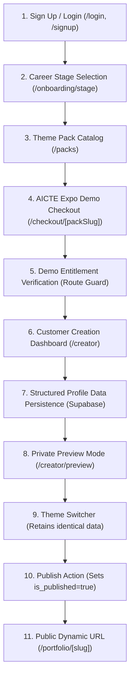

# Phase 1: Portfolio-as-a-Service (PaaS) Architecture & Migration Proposal
**Project:** Portfolio-as-a-Service — Purchase-First Multi-User Platform  
**Target Event:** AICTE Expo Demo  
**Status:** Awaiting User Approval before Phase 2 Implementation  

---

## 1. Executive Summary & Objective

This document outlines the architectural blueprint to extend the existing team portfolio website into a multi-user **Portfolio-as-a-Service (PaaS)** platform.

### Core Objectives
1. **Preserve Existing Value**: The current team portfolio showcase and existing admin dashboard will remain 100% operational.
2. **Multi-User Onboarding across 7 Career Stages**:
   - First-Year Engineering Student
   - Second-Year Engineering Student
   - Third-Year Engineering Student
   - Fourth-Year Engineering Student
   - Job Seeker
   - Experienced Working Professional
   - HR / Recruitment Professional
3. **Purchase-First Sequence with AICTE Expo Demo Logic**:
   - Users browse 3 Theme Packs with thumbnails, features, and listed prices:
     - **Student Starter Pack** — Listed Price: ₹199
     - **Developer Pro Pack** — Listed Price: ₹399
     - **Professional Elite Pack** — Listed Price: ₹599
   - Under AICTE Expo Demo conditions:
     - Listed price is prominently displayed alongside an **"AICTE Expo Demo — Free"** badge.
     - Actual amount payable is **₹0**.
     - Activating the demo pack simulates a real checkout flow, records a verified demo entitlement in Supabase, and unlocks the portfolio creator without requesting payment card details.
     - Explicitly transparent: simulated transactions are marked as **Demo Entitlements**, ready for future payment gateway plug-ins (e.g. Razorpay / Stripe).
4. **No Preview Before Purchase**: Full editable portfolio previews are strictly locked behind entitlement verification.
5. **Stage-Conditional Portfolio Creator Dashboard**:
   - Form fields dynamically adapt to the user's career stage (e.g. 1st-year students focus on coursework & foundational projects; professionals get comprehensive career timelines and metric milestones).
6. **3 Responsive Theme Engines**:
   - **Student Starter Theme**: Academic, coursework, certifications, club initiatives, and foundational projects.
   - **Developer Pro Theme**: Interactive tech portfolio with Sky Vivid design, GitHub stats, terminal shell, AI assistant, and code architectures.
   - **Professional Elite Theme**: Executive polish, leadership case studies, client recommendations, career timeline, and corporate credentials.
7. **Public Publication Pipeline**:
   - Unique slug allocation, draft vs. published state enforcement, and public route `/portfolio/[slug]`.
8. **Platform Administrator Extensions**:
   - Manage pack catalog, edit listed prices, toggle pack statuses, review demo activations, inspect user portfolios, and track platform usage analytics.

---

## 2. Codebase & Schema Audit (Current State vs. Required State)

### Existing Database Tables (Audited)
| Existing Table | Columns | Usability for PaaS | Action Required |
|---|---|---|---|
| `public.profiles` | `id`, `user_id`, `slug`, `full_name`, `professional_title`, `avatar_url`, `bio`, `resume_url`, `theme_color`, `created_at` | High | **Extend** with `career_stage`, `is_published`, `active_theme_pack`, `headline`, `location`, `phone`, `published_at` |
| `public.skills` | `id`, `profile_id`, `skill_name`, `category` | High | **Retain as-is**; reuse for user technical & soft skill categorization |
| `public.projects` | `id`, `profile_id`, `title`, `description`, `image_url`, `live_link`, `github_link`, `display_order` | High | **Extend** with `problem`, `solution`, `tech_stack`, `contribution` |
| `public.social_links` | `id`, `profile_id`, `platform`, `url` | High | **Retain as-is**; handles GitHub, LinkedIn, Twitter, Portfolio links |
| `public.posts` | `id`, `profile_id`, `title`, `content`, `summary`, `published_at` | High | **Retain as-is**; used for technical articles/blogs in Pro & Elite packs |
| `public.guestbook` | `id`, `profile_id`, `visitor_name`, `message`, `created_at` | High | **Retain as-is**; optional social proof feature |
| Storage Bucket `portfolio-assets` | Public bucket with RLS policies | High | **Retain as-is** for profile avatars, resume PDFs, project screenshots |

### Missing Database Tables & Entities Needed
1. `public.education`: Multi-record table storing degrees, colleges/schools, GPA/grades, graduation years, and academic honors.
2. `public.certifications`: Certifications, licensing bodies, verification IDs, and credential links.
3. `public.theme_packs`: Dynamic catalog defining the 3 packs, listed prices (₹199, ₹399, ₹599), active states, features JSON, and thumbnail URLs.
4. `public.user_entitlements`: Verified purchase/demo activation ledger linking `user_id` to `pack_id`, tracking demo status, listed price, amount paid (₹0 for demo), and entitlement validity.
5. `public.platform_admins`: Role-based administrator authorization table enforced by Postgres RLS (so client-side role tampering is impossible).

---

## 3. Detailed Database Schema Blueprint

```sql
-- ============================================================
-- 1. EXTEND PROFILES FOR PAAS MULTI-TENANCY
-- ============================================================
ALTER TABLE public.profiles 
  ADD COLUMN IF NOT EXISTS career_stage text DEFAULT 'first-year' 
    CHECK (career_stage IN ('first-year', 'second-year', 'third-year', 'fourth-year', 'job-seeker', 'professional', 'hr-recruiter')),
  ADD COLUMN IF NOT EXISTS headline text DEFAULT '',
  ADD COLUMN IF NOT EXISTS location text DEFAULT '',
  ADD COLUMN IF NOT EXISTS phone text DEFAULT '',
  ADD COLUMN IF NOT EXISTS is_published boolean DEFAULT false,
  ADD COLUMN IF NOT EXISTS active_theme_pack text DEFAULT 'student-starter',
  ADD COLUMN IF NOT EXISTS published_at timestamptz,
  ADD COLUMN IF NOT EXISTS updated_at timestamptz DEFAULT now();

-- ============================================================
-- 2. EXTEND PROJECTS WITH STRUCTURED CASE STUDY FIELDS
-- ============================================================
ALTER TABLE public.projects
  ADD COLUMN IF NOT EXISTS problem text DEFAULT '',
  ADD COLUMN IF NOT EXISTS solution text DEFAULT '',
  ADD COLUMN IF NOT EXISTS tech_stack text DEFAULT '',
  ADD COLUMN IF NOT EXISTS contribution text DEFAULT '';

-- ============================================================
-- 3. EDUCATION TABLE
-- ============================================================
CREATE TABLE IF NOT EXISTS public.education (
  id uuid PRIMARY KEY DEFAULT gen_random_uuid(),
  profile_id uuid NOT NULL REFERENCES public.profiles(id) ON DELETE CASCADE,
  institution text NOT NULL DEFAULT '',
  degree text NOT NULL DEFAULT '',
  field_of_study text DEFAULT '',
  start_year text DEFAULT '',
  end_year text DEFAULT '',
  grade_cgpa text DEFAULT '',
  achievements text DEFAULT '',
  display_order integer DEFAULT 0,
  created_at timestamptz DEFAULT now()
);

-- ============================================================
-- 4. CERTIFICATIONS & ACHIEVEMENTS TABLE
-- ============================================================
CREATE TABLE IF NOT EXISTS public.certifications (
  id uuid PRIMARY KEY DEFAULT gen_random_uuid(),
  profile_id uuid NOT NULL REFERENCES public.profiles(id) ON DELETE CASCADE,
  title text NOT NULL DEFAULT '',
  issuer text NOT NULL DEFAULT '',
  issue_date text DEFAULT '',
  expiry_date text DEFAULT '',
  credential_id text DEFAULT '',
  credential_url text DEFAULT '',
  display_order integer DEFAULT 0,
  created_at timestamptz DEFAULT now()
);

-- ============================================================
-- 5. THEME PACKS CATALOG TABLE
-- ============================================================
CREATE TABLE IF NOT EXISTS public.theme_packs (
  id uuid PRIMARY KEY DEFAULT gen_random_uuid(),
  slug text UNIQUE NOT NULL,
  name text NOT NULL,
  tagline text DEFAULT '',
  listed_price integer NOT NULL DEFAULT 199, -- in INR
  currency text DEFAULT 'INR',
  is_active boolean DEFAULT true,
  thumbnail_url text DEFAULT '',
  recommended_for text[] DEFAULT ARRAY[]::text[],
  features jsonb DEFAULT '[]'::jsonb,
  display_order integer DEFAULT 0,
  created_at timestamptz DEFAULT now(),
  updated_at timestamptz DEFAULT now()
);

-- ============================================================
-- 6. USER ENTITLEMENTS & DEMO TRANSACTIONS TABLE
-- ============================================================
CREATE TABLE IF NOT EXISTS public.user_entitlements (
  id uuid PRIMARY KEY DEFAULT gen_random_uuid(),
  user_id uuid NOT NULL REFERENCES auth.users(id) ON DELETE CASCADE,
  pack_slug text NOT NULL REFERENCES public.theme_packs(slug) ON DELETE RESTRICT,
  status text NOT NULL DEFAULT 'active' CHECK (status IN ('active', 'expired', 'revoked')),
  is_demo boolean NOT NULL DEFAULT true,
  listed_price_inr integer NOT NULL,
  amount_paid_inr integer NOT NULL DEFAULT 0,
  transaction_ref text NOT NULL,
  notes text DEFAULT 'AICTE Expo Demo Activation — 100% Free Pass',
  activated_at timestamptz DEFAULT now()
);

-- ============================================================
-- 7. PLATFORM ADMINISTRATOR ACCESS
-- ============================================================
CREATE TABLE IF NOT EXISTS public.platform_admins (
  id uuid PRIMARY KEY DEFAULT gen_random_uuid(),
  user_id uuid UNIQUE NOT NULL REFERENCES auth.users(id) ON DELETE CASCADE,
  role text NOT NULL DEFAULT 'superadmin',
  created_at timestamptz DEFAULT now()
);

-- ============================================================
-- 8. ROW LEVEL SECURITY (RLS) POLICIES
-- ============================================================
ALTER TABLE public.education ENABLE ROW LEVEL SECURITY;
ALTER TABLE public.certifications ENABLE ROW LEVEL SECURITY;
ALTER TABLE public.theme_packs ENABLE ROW LEVEL SECURITY;
ALTER TABLE public.user_entitlements ENABLE ROW LEVEL SECURITY;
ALTER TABLE public.platform_admins ENABLE ROW LEVEL SECURITY;

-- THEME PACKS: Public read for catalog display; Platform Admin write
CREATE POLICY "Theme packs are viewable by everyone"
  ON public.theme_packs FOR SELECT USING (true);

CREATE POLICY "Platform admins can update theme packs"
  ON public.theme_packs FOR ALL
  USING (EXISTS (SELECT 1 FROM public.platform_admins WHERE platform_admins.user_id = auth.uid()))
  WITH CHECK (EXISTS (SELECT 1 FROM public.platform_admins WHERE platform_admins.user_id = auth.uid()));

-- ENTITLEMENTS: Users can view their own entitlements; Platform Admins can view all
CREATE POLICY "Users can read own entitlements"
  ON public.user_entitlements FOR SELECT
  USING (auth.uid() = user_id OR EXISTS (SELECT 1 FROM public.platform_admins WHERE platform_admins.user_id = auth.uid()));

CREATE POLICY "Users can insert demo entitlements for themselves"
  ON public.user_entitlements FOR INSERT
  WITH CHECK (auth.uid() = user_id);

-- EDUCATION & CERTIFICATIONS: Private owner write; Public read ONLY if profile is published
CREATE POLICY "Owner can manage education"
  ON public.education FOR ALL
  USING (EXISTS (SELECT 1 FROM public.profiles WHERE profiles.id = education.profile_id AND profiles.user_id = auth.uid()))
  WITH CHECK (EXISTS (SELECT 1 FROM public.profiles WHERE profiles.id = education.profile_id AND profiles.user_id = auth.uid()));

CREATE POLICY "Public can view education of published profiles"
  ON public.education FOR SELECT
  USING (EXISTS (SELECT 1 FROM public.profiles WHERE profiles.id = education.profile_id AND profiles.is_published = true));

CREATE POLICY "Owner can manage certifications"
  ON public.certifications FOR ALL
  USING (EXISTS (SELECT 1 FROM public.profiles WHERE profiles.id = certifications.profile_id AND profiles.user_id = auth.uid()))
  WITH CHECK (EXISTS (SELECT 1 FROM public.profiles WHERE profiles.id = certifications.profile_id AND profiles.user_id = auth.uid()));

CREATE POLICY "Public can view certifications of published profiles"
  ON public.certifications FOR SELECT
  USING (EXISTS (SELECT 1 FROM public.profiles WHERE profiles.id = certifications.profile_id AND profiles.is_published = true));
```

---

## 4. Required User Journey & Route Architecture



### Route Map
1. **`/`** — Main Team Landing Page (Preserved; shows current team portfolios + CTA button: "Create Your Own Portfolio").
2. **`/login` & `/signup`** — Customer & Team authentication entry.
3. **`/onboarding/stage`** — Interactive Career Stage selector with cards for each of the 7 stages.
4. **`/packs`** — Theme Pack Showcase (features, watermarked preview badges, listed prices: ₹199, ₹399, ₹599, and "AICTE Expo Demo — Free" pills).
5. **`/checkout/[packSlug]`** — Demo Checkout Simulator: displays listed price, AICTE Expo Demo ₹0 waiver, breakdown receipt, and "Activate Demo Pack" CTA.
6. **`/creator`** — The Customer Creation Dashboard:
   - Stage-conditional navigation:
     - 🎓 Academics (1st/2nd/3rd/4th years & entry level)
     - 💼 Work Experience / Internships (hidden/optional for 1st-year students; required for professionals)
     - 🛠️ Tech & Core Skills
     - 🚀 Projects with Problem, Solution, Tech Stack, Contribution
     - 🏆 Certifications & Competitions
     - 🌐 Social & Resume File Upload
   - Save draft, progress bar, real-time feedback, and slug reservation.
7. **`/creator/preview`** — Private interactive preview of the portfolio before publishing.
8. **`/portfolio/[slug]`** — The Public Dynamic Route:
   - Checks `is_published === true` (or owner session if previewing).
   - Dynamically selects and renders Theme Engine 1, 2, or 3 based on `active_theme_pack`.
9. **`/admin/*`** — Existing team member editor preserved, plus new sub-pages:
   - `/admin/packs`: Edit pack listed prices (₹199, ₹399, ₹599), toggle activation.
   - `/admin/entitlements`: Audit list of all demo activations and future transactions.
   - `/admin/portfolios`: Manage publication states, review student submissions.
   - `/admin/analytics`: Stage breakdown, popular packs, conversion metrics.

---

## 5. Theme Pack & Theme Engine Specifications

| Theme Pack | Listed Price | Target Audience | Key Differentiators in Theme Engine |
|---|---|---|---|
| **1. Student Starter Pack** (`student-starter`) | **₹199** *(Demo: ₹0)* | 1st & 2nd Year Students, Beginners | Clean, academic-first presentation; highlights degree, coursework, lab skills, certifications, club activities, and foundational projects with problem/solution cards. |
| **2. Developer Pro Pack** (`developer-pro`) | **₹399** *(Demo: ₹0)* | 3rd & 4th Year Students, Tech Job Seekers | Full interactive Sky Vivid tech stack; live GitHub API repository counters, project architecture tags, integrated CLI terminal, and AI profile agent. |
| **3. Professional Elite Pack** (`professional-elite`) | **₹599** *(Demo: ₹0)* | Experienced Engineers, Managers, HR Professionals | Executive corporate styling; metric-driven career timeline, client testimonials, case studies, high-contrast typography, and instant resume download triggers. |

> [!IMPORTANT]
> **Data Integrity Guarantee**: Switching theme packs will **never** delete, alter, or duplicate profile records. All 3 themes consume the exact same normalized Supabase tables (`profiles`, `education`, `skills`, `projects`, `certifications`, `social_links`).

---

## 6. Phase-by-Phase Implementation Plan

### **Phase 1: Project Audit and Architecture Proposal (Current Phase)**
- **Scope**: Perform codebase audit, analyze database schema, design PaaS extensions, and present blueprint.
- **Output**: This file (`PHASE_1_PORTFOLIO_AS_A_SERVICE_PROPOSAL.md`).
- **Checkpoint**: Await user review and approval before touching code.

---

### **Phase 2: Database Migration & Theme Pack Catalog**
- **Deliverables**:
  - `supabase_paas_migration.sql`: Incremental migration script adding new columns and tables without dropping existing data.
  - TypeScript definitions extended in [`src/types/database.types.ts`](file:///c:/Users/mounika/port/src/types/database.types.ts).
  - Pack Catalog page at `/packs` with watermarked thumbnails, feature lists, and listed prices.
  - Demo Checkout page at `/checkout/[packSlug]` with ₹0 Expo waiver and database entitlement creation.
- **Verification**: Database migration applied; seed packs loaded; test checkout creates valid `user_entitlements` record.

---

### **Phase 3: Career Stage Onboarding & Purchase-First Route Guard**
- **Deliverables**:
  - `/onboarding/stage`: 7 career-stage selection modal/page with persistence to profile.
  - Next.js Server & Client Route Guards: Blocking `/creator` access until active entitlement exists for the logged-in user.
- **Verification**: Unauthenticated or un-entitled users are redirected to `/packs`; entitled users pass straight to `/creator`.

---

### **Phase 4: Customer Dashboard & Conditional Profile Forms**
- **Deliverables**:
  - Multi-step customer creator dashboard at `/creator` with progress indicators.
  - Conditional field rendering based on career stage:
    - *1st-Year Students*: Education, Foundation Skills, Coursework, Mini-Projects, Academic Interests (Experience section hidden).
    - *2nd/3rd-Year Students*: Education, Skills, Problem-Solution Projects, Hackathons/Certifications.
    - *4th-Year / Job Seekers*: Full Projects, GitHub/Live links, Internships, Resume upload, Technical skills.
    - *Experienced Professionals*: Career Timeline milestones, Leadership impact, Testimonials, Architecture Case Studies.
  - Save Draft and Resume Later mechanisms.
- **Verification**: Profile, education, certifications, and extended projects save and update without error.

---

### **Phase 5: 3 Theme Engines & Private Preview**
- **Deliverables**:
  - **Theme 1 (Student Starter Engine)**: `src/components/themes/StudentStarterTheme.tsx`
  - **Theme 2 (Developer Pro Engine)**: `src/components/themes/DeveloperProTheme.tsx`
  - **Theme 3 (Professional Elite Engine)**: `src/components/themes/ProfessionalEliteTheme.tsx`
  - Theme Switcher component inside private preview at `/creator/preview`.
- **Verification**: User can preview their portfolio privately; switching themes seamlessly alters presentation without touching underlying database data.

---

### **Phase 6: Publication Flow & Public Portfolio Routing**
- **Deliverables**:
  - Publish modal with custom slug validation and confirmation.
  - Public route `/portfolio/[slug]` updated:
    - Verifies `is_published === true` before exposing data to public visitors.
    - Dynamically renders the selected active theme pack.
  - Mobile responsiveness verification across all 3 themes.
- **Verification**: Opening incognito window to `/portfolio/[slug]` displays the published portfolio; unpublished drafts return a friendly 404/Private page.

---

### **Phase 7: Admin Dashboard Extensions**
- **Deliverables**:
  - `/admin/packs`: Admin interface to update pack prices (₹199, ₹399, ₹599), descriptions, and active status.
  - `/admin/entitlements`: List of users and their activated demo packs.
  - `/admin/portfolios`: Platform-wide list of user portfolios with publication status toggles.
  - `/admin/analytics`: Visual summary of user stages, popular themes, and demo registrations.
- **Verification**: Admin can change listed prices and see real-time updates reflected on `/packs` and `/checkout`.

---

### **Phase 8: Comprehensive End-to-End Verification & Expo Demo Dry-Run**
- **Deliverables**:
  - Full end-to-end journey execution:
    1. Sign up a fresh test user (`test_student@example.com`).
    2. Choose career stage (e.g. `first-year`).
    3. Browse `/packs` → select *Developer Pro Pack* (Listed: ₹399, Demo: ₹0).
    4. Activate free demo pack → Entitlement granted.
    5. Fill in profile, academics, skills, and projects.
    6. Preview in Developer Pro Theme → Switch to Student Starter Theme.
    7. Publish portfolio with slug `expo-demo`.
    8. Open incognito link `http://localhost:3000/portfolio/expo-demo`.
    9. Edit bio and verify instant live update.
  - Sign in as a second user to confirm RLS isolation (User 2 cannot view or edit User 1's unpublished drafts).
- **Verification**: Clean `next build` with 0 errors; full journey documented.

---

## 7. Next Steps & Approval Request

This document establishes the architecture for the platform.  
No code or database modifications have been made yet, in adherence to your instructions:
> *"Now change accoding to my provided features in a empty file and wait for my approvel to change"*

**Please reply to approve this Phase 1 blueprint so we may begin Phase 2: Database Migration & Theme Pack Catalog.**
